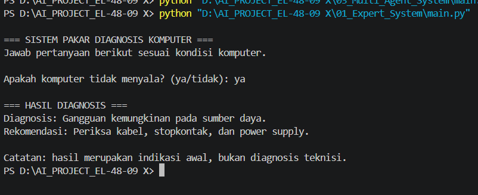

# Expert System — Computer Troubleshooting

## Deskripsi
Program sistem pakar berbasis aturan IF-THEN untuk memberikan indikasi awal gangguan komputer berdasarkan gejala yang dimasukkan pengguna.

## Teknologi
- Python
- Visual Studio Code
- Python Standard Library

## Cara Menjalankan
```bash
python main.py
```

## Cara Kerja
Program meminta pengguna menjawab pertanyaan tentang kondisi komputer. Jawaban diproses melalui aturan keputusan untuk menghasilkan diagnosis dan rekomendasi.

## Pengujian Lokal
- Sistem operasi: Windows
- Tanggal pengujian: 16 oktober 2026
- Input: Apakah komputer tidak menyala? (ya/tidak):
- Output: ya
- Status: === HASIL DIAGNOSIS ===
Diagnosis: Gangguan kemungkinan pada sumber daya.
Rekomendasi: Periksa kabel, stopkontak, dan power supply.

Catatan: hasil merupakan indikasi awal, bukan diagnosis teknisi.
## Bukti Running


## Kesimpulan
Sistem berhasil menerapkan aturan IF-ELSE untuk mendiagnosis kemungkinan gangguan komputer berdasarkan jawaban pengguna dan memberikan rekomendasi penanganan.

## Pengembangan
Program dapat dikembangkan dengan menambah aturan, gejala, dan basis pengetahuan yang lebih luas.
