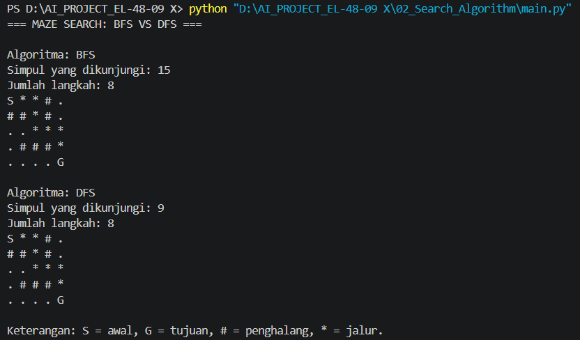

# Search Algorithm — Maze Solver

## Deskripsi
Proyek ini mengimplementasikan algoritma Breadth-First Search (BFS) dan Depth-First Search (DFS) untuk mencari jalur dari titik awal menuju titik tujuan pada labirin.

## Teknologi
- Python
- Visual Studio Code

## Algoritma
- **BFS:** Menelusuri simpul berdasarkan tingkat kedalaman dan menemukan jalur terpendek pada labirin tanpa bobot.
- **DFS:** Menelusuri jalur lebih dalam terlebih dahulu sebelum mencoba jalur lainnya.

## Cara Menjalankan
Pastikan Python sudah terpasang, kemudian jalankan perintah berikut di terminal:

```bash
python main.py
```

## Hasil Pengujian
Program menampilkan jumlah simpul yang dikunjungi, jumlah langkah jalur, dan visualisasi labirin untuk BFS dan DFS.

## Screenshot


## Kesimpulan
Algoritma BFS dan DFS berhasil diterapkan untuk mencari jalur dalam labirin. Keduanya memiliki strategi pencarian dan karakteristik hasil yang berbeda.