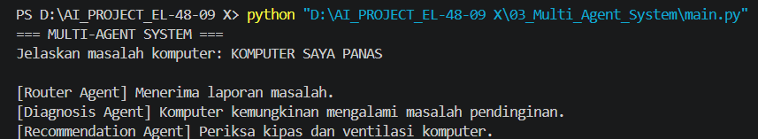

# Multi-Agent System — Computer Troubleshooting

## Deskripsi
Proyek ini merupakan simulasi Multi-Agent System untuk menganalisis gangguan komputer dan memberikan rekomendasi penanganan berdasarkan masukan pengguna.

## Teknologi
- Python
- Visual Studio Code

## Komponen Agen
- **Router Agent:** Mengatur alur pemrosesan masukan.
- **Diagnosis Agent:** Mengidentifikasi kemungkinan gangguan komputer.
- **Recommendation Agent:** Memberikan rekomendasi berdasarkan hasil diagnosis.

## Cara Menjalankan
Pastikan Python sudah terpasang, kemudian jalankan perintah berikut di terminal:

```bash
python main.py
```

Masukkan gejala komputer, misalnya:

```text
komputer saya panas
```

## Hasil Pengujian
Program menampilkan proses diagnosis dan rekomendasi berdasarkan masukan pengguna.

## Screenshot


## Kesimpulan
Sistem berhasil menyimulasikan kerja sama tiga agen dengan tugas berbeda untuk menganalisis gangguan komputer dan memberikan rekomendasi penanganan.

## Catatan
Sistem masih menggunakan aturan sederhana dan berjalan secara lokal. Agen belum berupa model AI independen.